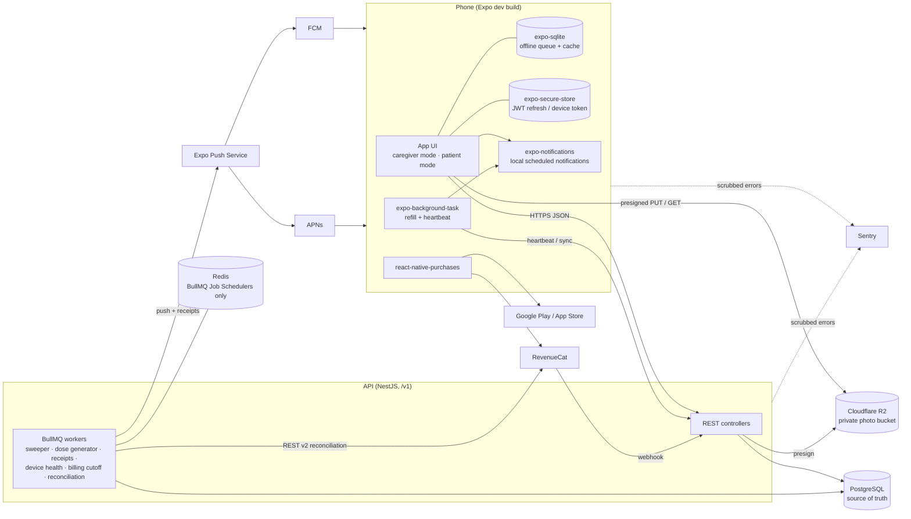

# Architecture

## Components

### How they talk

| From → To | Channel | Purpose |
| --- | --- | --- |
| App → API | HTTPS REST under `/v1`, JSON; caregiver JWT or patient device token | All CRUD, sync, answers, heartbeat ([04](04-api.md)) |
| App → R2 | Presigned `PUT` (upload) and `GET` (read), short-lived | Medicine photos ([10](10-security-privacy.md#photos)) |
| API → Postgres | Drizzle ORM | Source of truth for doses, alerts, devices, billing |
| Workers ↔ Redis | BullMQ Job Schedulers + queues | Triggers only; all state in Postgres ([D-071](01-decisions.md#d-071-bullmq-job-schedulers-replace-repeatable-jobs)) |
| Workers → Expo Push → FCM/APNs | HTTPS; tickets then receipts | Conditional backup, missed alerts, corrections, device alerts, data pushes |
| App → RevenueCat → stores | SDK purchase flow | Subscriptions |
| RevenueCat → API | Webhook (auth header, optional HMAC) | Subscription events, deduped by event `id` |
| Workers → RevenueCat | REST API v2 | Daily reconciliation and per-event refetch |
| App, API → Sentry | SDK, scrubbed | Errors and performance; no medicine names, notes, photos |

### Processes

| Process | Runs | Scaling |
| --- | --- | --- |
| `api` | NestJS HTTP server | Stateless, horizontal |
| `worker` | NestJS app context with BullMQ workers | Horizontal. The sweeper is safe to run concurrently thanks to `FOR UPDATE SKIP LOCKED` |
| `scheduler` registration | On worker boot: `upsertJobScheduler` for each repeating job (idempotent by ID) | Any worker may upsert |

### Repeating jobs (BullMQ Job Schedulers)

| Scheduler ID | Cadence | Doc |
| --- | --- | --- |
| `sweeper` | every 60 s | [05](05-reminder-engine.md#minute-sweeper), [09](09-missed-dose-alerts.md) |
| `dose-generator` | daily, plus on-demand after edits/timezone changes | [05](05-reminder-engine.md#dose-generation) |
| `push-receipts` | every 15 min (receipts are ready after about 15 min and deleted after 24 h, [R-08](references.md)) | [05](05-reminder-engine.md#push-delivery-and-receipts) |
| `device-health` | every 15 min | [09](09-missed-dose-alerts.md#device-problem-alerts) |
| `billing-cutoff` | every 60 s (inside the sweeper run or separate) | [07](07-subscriptions-and-billing.md#cutoff) |
| `rc-reconcile` | daily | [07](07-subscriptions-and-billing.md#reconciliation) |

## Stack and checked versions

All checked on 2026-10-28; see [references.md](references.md). Pin exact versions in lockfiles. Re-check before Phase 0 and Phase 5.

### Mobile

| Item | Version | Note |
| --- | --- | --- |
| Expo SDK | **58** (`expo` 58.0.20) | Development build via `expo-dev-client` 58.0.16 |
| React Native / React | 0.88 (0.88.1) / 19.3.0 | Per SDK 58 |
| Minimum OS | iOS 16.4, Android 7 | targetSdk 36, compileSdk 37 (SDK 58 defaults) |
| Notifications | `expo-notifications` 58.1.6 | Local scheduling, categories/actions, channels, push token |
| Secure storage | `expo-secure-store` 58.0.2 | `AFTER_FIRST_UNLOCK` so background tasks can read the device token |
| Local DB | `expo-sqlite` 58.0.14 | WAL; offline answer queue, dose cache |
| Background work | `expo-background-task` 58.0.11 (+ `expo-task-manager` 58.0.12) | Refill and heartbeat |
| Device state (Android) | `expo-battery` 58.0.3, `expo-intent-launcher` 58.0.3 | `battery_unrestricted` check and battery-optimisation settings list (D-074, [R-49, R-50](references.md)) |
| Attestation | `@expo/app-integrity` 58.0.2 | Play Integrity + App Attest (D-013) |
| Camera / QR | `expo-camera` 58.0.13 | Scan pairing QR |
| Photos | `expo-image-picker` 58.0.10, `expo-image-manipulator` 58.0.15 | Pick, resize, re-encode |
| Updates | `expo-updates` 58.0.18, `eas-cli` 26.0.0 | EAS Update channels and rollouts |
| Sign-in | Email + password against our API ([D-095](01-decisions.md#d-095-caregiver-sign-in-is-email--password-in-v1)) | v1.1: `expo-apple-authentication` (58.0.2 when checked), `@react-native-google-signin/google-signin` (16.1.5 when checked); re-check versions then |
| Billing | `react-native-purchases` 10.16.0 | RevenueCat SDK |
| i18n | `expo-localization` 58.0.5, `i18next` 26.5.11, `react-i18next` 17.1.9 | English only at launch |
| Errors | `@sentry/react-native` 8.32.0 | Scrubbing in `beforeSend` / `beforeBreadcrumb` |

### Backend

| Item | Version | Note |
| --- | --- | --- |
| Node.js | **26 LTS** (26.12.1) | Node 26 enters Active LTS 2026-10-28 per the release schedule; Node 24 is in Maintenance from 2026-10-20 ([R-12](references.md)) |
| NestJS | 12 (`@nestjs/core` 12.3.2) | ESM-only packages; prefer Vitest (Jest needs Node 24.9+ for ESM) ([R-13](references.md)) |
| Queue | `bullmq` 6.5.0, `@nestjs/bullmq` 12.0.0 | Job Schedulers |
| Redis client | `ioredis` 6.0.0 | Workers: `maxRetriesPerRequest: null`. Redis: AOF on, `maxmemory-policy noeviction` ([R-17](references.md)) |
| Redis server | *not yet checked* | Check the BullMQ minimum in Phase 1 |
| PostgreSQL | **18** (18.6) | 19 is at RC; don't adopt before GA + first minor |
| ORM | `drizzle-orm` 0.45.4, `drizzle-kit` 0.31.11 | 1.0 at RC ([D-089](01-decisions.md#d-089-drizzle-045x)) |
| Postgres driver | `pg` 8.23.1 | |
| Auth | `@nestjs/jwt` 12.0.3, `@nestjs/throttler` 6.7.1, `@node-rs/argon2` 2.2.2 (or `argon2` 0.45.1) | Argon2id per OWASP ([R-47](references.md)) |
| Push | `expo-server-sdk` 8.0.0 | Access token if enhanced security is enabled ([D-090](01-decisions.md#d-090-expo-push-access-token)) |
| Object storage | `@aws-sdk/client-s3` / `@aws-sdk/s3-request-presigner` 3.1158.0 | R2 S3 API endpoint (no custom domain for presigned URLs) |
| Errors | `@sentry/nestjs` 11.9.0 | |
| Billing | RevenueCat REST API v2 | Secret key, server only |

## Module layout (API)

| Nest module | Owns tables | Doc |
| --- | --- | --- |
| `auth` | `users`, `auth_sessions` | [04](04-api.md#auth) |
| `patients` | `patients`, `caregiver_settings` | [04](04-api.md#patients) |
| `pairing` | `pairing_codes` | [06](06-pairing-and-devices.md) |
| `devices` | `devices` | [06](06-pairing-and-devices.md) |
| `medicines` | `medicines`, `schedule_versions`, `schedule_times` | [05](05-reminder-engine.md) |
| `doses` | `dose_instances` | [05](05-reminder-engine.md) |
| `notify` | `notification_log` | [05](05-reminder-engine.md#push-delivery-and-receipts), [09](09-missed-dose-alerts.md) |
| `billing` | `subscriptions` | [07](07-subscriptions-and-billing.md) |
| `audit` | `audit_log` | [10](10-security-privacy.md#audit-log) |
| `uploads` | — | [10](10-security-privacy.md#photos) |
| `config` | — | [14](14-release-and-ops.md#minimum-version-and-app-config) |

## App structure

- **Mode switch** at the root: caregiver stack (JWT) and patient stack (device token). Both can be present ([D-009](01-decisions.md#d-009-dual-roles-on-one-phone)).
- **Local DB** tables: `profiles` (patient profiles on this phone, including self), `doses` (window cache), `medicines` (cache + photo path), `outbox` (answers with `client_event_id`), `scheduled` (notification IDs → dose IDs).
- **Scheduler module**: given all dose windows on the phone, allocates the notification budget ([05](05-reminder-engine.md#window-size)) and reconciles scheduled notifications with the server window.
