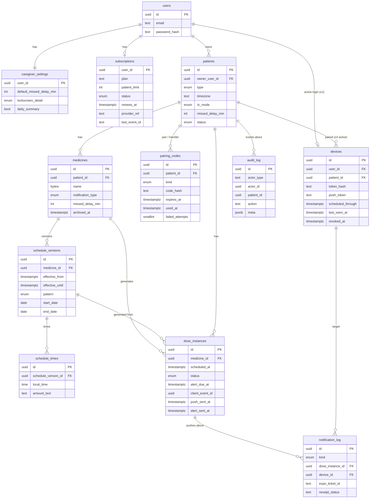

# Data model

PostgreSQL 18 + Drizzle ORM ([02](02-architecture.md#backend)). Postgres is the source of truth for every dose and alert ([D-033](01-decisions.md#d-033-postgres-is-the-source-of-truth)).

Conventions:
- Primary keys are `uuid` (v7, generated in the app for sortable IDs). Timestamps are `timestamptz` in UTC.
- Columns tagged `// D-082` were added by [D-082](01-decisions.md#d-082-schema-additions) to implement agreed behaviour. The supporting tables are in their own section.
- Columns tagged `// encrypted` hold ciphertext from application-level field encryption ([10](10-security-privacy.md#field-level-encryption)). They can't be searched or sorted in SQL.

## Canonical enums

| Enum | Values |
| --- | --- |
| `patient_type` | `managed`, `self` |
| `patient_status` | `active`, `suspended`, `archived` |
| `tz_mode` | `follow_device`, `fixed` |
| `notification_type` | `standard`, `alarm`, `gentle` |
| `schedule_pattern` | `daily`, `weekdays`, `every_n_days` |
| `dose_status` | `pending`, `snoozed`, `taken`, `not_taken`, `missed` |
| `pairing_code_kind` | `pair`, `transfer` |
| `notification_kind` | `backup`, `missed`, `correction`, `device_health`, `not_taken`, `window_low`, `billing`, `pairing`, `sync` ([D-082](01-decisions.md#d-082-schema-additions)) |
| `lockscreen_detail` | `full`, `generic` |
| `platform` | `ios`, `android` |
| `subscription_status` | `active`, `store_grace`, `grace`, `expired` |

`store_grace` = the store's own billing grace (entitlement still active). `grace` = our 1-day grace after the store reports expiry. `expired` = past cutoff ([07](07-subscriptions-and-billing.md)).

## Schema sketch (Drizzle, `drizzle-orm/pg-core`)

```ts
import { sql } from "drizzle-orm";
import {
  pgTable, pgEnum, uuid, text, integer, smallint, boolean, date, time,
  timestamp, jsonb, customType, index, uniqueIndex, unique, check,
} from "drizzle-orm/pg-core";

const bytea = customType<{ data: Buffer }>({ dataType: () => "bytea" });
const ts = (name: string) => timestamp(name, { withTimezone: true });

export const patientType = pgEnum("patient_type", ["managed", "self"]);
export const patientStatus = pgEnum("patient_status", ["active", "suspended", "archived"]);
export const tzMode = pgEnum("tz_mode", ["follow_device", "fixed"]);
export const notificationType = pgEnum("notification_type", ["standard", "alarm", "gentle"]);
export const schedulePattern = pgEnum("schedule_pattern", ["daily", "weekdays", "every_n_days"]);
export const doseStatus = pgEnum("dose_status", ["pending", "snoozed", "taken", "not_taken", "missed"]);
export const pairingCodeKind = pgEnum("pairing_code_kind", ["pair", "transfer"]);
export const notificationKind = pgEnum("notification_kind", [
  "backup", "missed", "correction", "device_health",
  "not_taken", "window_low", "billing", "pairing", "sync",   // D-082
]);
export const lockscreenDetail = pgEnum("lockscreen_detail", ["full", "generic"]);
export const platform = pgEnum("platform", ["ios", "android"]);
export const subscriptionStatus = pgEnum("subscription_status", ["active", "store_grace", "grace", "expired"]);

// ── users ────────────────────────────────────────────────────────────────
export const users = pgTable("users", {
  id: uuid().primaryKey(),
  email: text().notNull(),                     // trimmed, lower-cased; not verified in v1 (D-095)
  passwordHash: text("password_hash").notNull(), // Argon2id PHC string (D-095)
  // v1.1: email_verified_at, google_sub, apple_sub (OTP / Google / Apple sign-in)
  createdAt: ts("created_at").notNull().defaultNow(),
  deletedAt: ts("deleted_at"),                 // account deletion (D-081), data erased per C-10
}, (t) => [
  uniqueIndex("users_email_uq").on(t.email),
]);

// ── caregiver_settings ───────────────────────────────────────────────────
export const caregiverSettings = pgTable("caregiver_settings", {
  userId: uuid("user_id").primaryKey().references(() => users.id),
  defaultMissedDelayMin: integer("default_missed_delay_min").notNull().default(30),
  lockscreenDetail: lockscreenDetail("lockscreen_detail").notNull().default("full"),
  dailySummary: boolean("daily_summary").notNull().default(false),  // v1.1 (D-082)
  updatedAt: ts("updated_at").notNull().defaultNow(),
}, (t) => [
  check("missed_delay_positive", sql`${t.defaultMissedDelayMin} > 0`),
]);

// ── patients ─────────────────────────────────────────────────────────────
export const patients = pgTable("patients", {
  id: uuid().primaryKey(),
  ownerUserId: uuid("owner_user_id").notNull().references(() => users.id),
  displayName: bytea("display_name").notNull(),          // D-082, encrypted
  type: patientType().notNull().default("managed"),
  timezone: text().notNull(),                            // IANA, e.g. "Asia/Kolkata"
  tzMode: tzMode("tz_mode").notNull().default("follow_device"),
  missedDelayMin: integer("missed_delay_min"),           // null → caregiver default
  lockscreenDetail: lockscreenDetail("lockscreen_detail"), // D-082; null → caregiver setting
  status: patientStatus().notNull().default("active"),
  suspendedAt: ts("suspended_at"),
  archivedAt: ts("archived_at"),
  createdAt: ts("created_at").notNull().defaultNow(),
  updatedAt: ts("updated_at").notNull().defaultNow(),
}, (t) => [
  index("patients_owner_idx").on(t.ownerUserId, t.status),
  // one self profile per caregiver (D-092)
  uniqueIndex("patients_one_self_uq").on(t.ownerUserId).where(sql`${t.type} = 'self' and ${t.status} <> 'archived'`),
  check("patients_missed_delay_positive", sql`${t.missedDelayMin} is null or ${t.missedDelayMin} > 0`),
]);

// ── devices ──────────────────────────────────────────────────────────────
// A row is either a caregiver login device (user_id) or a patient device (patient_id).
export const devices = pgTable("devices", {
  id: uuid().primaryKey(),
  userId: uuid("user_id").references(() => users.id),
  patientId: uuid("patient_id").references(() => patients.id),
  tokenHash: text("token_hash"),             // patient devices: HMAC-SHA256 of device token
  pushToken: text("push_token"),             // ExponentPushToken[...]
  pushInvalidAt: ts("push_invalid_at"),      // D-082: set on DeviceNotRegistered
  platform: platform().notNull(),
  label: text(),                             // D-082: "Pixel 8", shown to caregiver
  appVersion: text("app_version"),
  tz: text(),                                // IANA reported by the phone
  permNotifications: boolean("perm_notifications"),
  permExactAlarm: boolean("perm_exact_alarm"),          // Android
  permBatteryUnrestricted: boolean("perm_battery_unrestricted"), // Android
  permTimeSensitive: boolean("perm_time_sensitive"),    // iOS
  scheduledThrough: ts("scheduled_through"),
  lastSeenAt: ts("last_seen_at"),
  revokedAt: ts("revoked_at"),
  createdAt: ts("created_at").notNull().defaultNow(),
}, (t) => [
  check("devices_one_owner", sql`(${t.userId} is null) <> (${t.patientId} is null)`),
  check("devices_patient_has_token", sql`${t.patientId} is null or ${t.tokenHash} is not null`),
  uniqueIndex("devices_token_hash_uq").on(t.tokenHash).where(sql`${t.tokenHash} is not null`),
  // one active login per caregiver (D-019)
  uniqueIndex("devices_one_caregiver_login_uq").on(t.userId).where(sql`${t.userId} is not null and ${t.revokedAt} is null`),
  index("devices_patient_active_idx").on(t.patientId).where(sql`${t.revokedAt} is null`),
  // ≤ 3 active per patient is enforced in the redeem transaction (count under patient row lock)
]);

// ── pairing_codes ────────────────────────────────────────────────────────
export const pairingCodes = pgTable("pairing_codes", {
  id: uuid().primaryKey(),
  patientId: uuid("patient_id").notNull().references(() => patients.id),
  kind: pairingCodeKind().notNull(),
  createdByUserId: uuid("created_by_user_id").notNull().references(() => users.id),
  lookupHash: text("lookup_hash").notNull(),  // D-084: HMAC of first 4 symbols
  codeHash: text("code_hash").notNull(),      // HMAC-SHA256(pepper, normalized 8 symbols)
  expiresAt: ts("expires_at").notNull(),      // created_at + 10 min
  usedAt: ts("used_at"),
  invalidatedAt: ts("invalidated_at"),        // superseded by a newer code for the same patient + kind
  failedAttempts: smallint("failed_attempts").notNull().default(0), // 5 → locked
  createdAt: ts("created_at").notNull().defaultNow(),
}, (t) => [
  // at most one live code per patient and kind
  uniqueIndex("pairing_codes_live_uq").on(t.patientId, t.kind)
    .where(sql`${t.usedAt} is null and ${t.invalidatedAt} is null`),
  index("pairing_codes_lookup_idx").on(t.lookupHash)
    .where(sql`${t.usedAt} is null and ${t.invalidatedAt} is null`),
]);

// ── medicines ────────────────────────────────────────────────────────────
export const medicines = pgTable("medicines", {
  id: uuid().primaryKey(),
  patientId: uuid("patient_id").notNull().references(() => patients.id),
  name: bytea().notNull(),                    // encrypted
  notes: bytea(),                             // encrypted
  photoObjectKey: text("photo_object_key"),   // D-082: R2 key
  notificationType: notificationType("notification_type").notNull().default("standard"),
  missedDelayMin: integer("missed_delay_min"),   // null → patient → caregiver default
  stockCount: integer("stock_count"),            // v1.1
  lowStockAt: integer("low_stock_at"),           // v1.1 threshold
  archivedAt: ts("archived_at"),
  createdAt: ts("created_at").notNull().defaultNow(),
  updatedAt: ts("updated_at").notNull().defaultNow(),
}, (t) => [
  index("medicines_patient_idx").on(t.patientId).where(sql`${t.archivedAt} is null`),
  check("medicines_missed_delay_positive", sql`${t.missedDelayMin} is null or ${t.missedDelayMin} > 0`),
]);

// ── schedule_versions ────────────────────────────────────────────────────
export const scheduleVersions = pgTable("schedule_versions", {
  id: uuid().primaryKey(),
  medicineId: uuid("medicine_id").notNull().references(() => medicines.id),
  effectiveFrom: ts("effective_from").notNull(),
  effectiveUntil: ts("effective_until"),       // null = current version
  pattern: schedulePattern().notNull(),
  daysOfWeek: smallint("days_of_week").array(),  // ISO 1=Mon..7=Sun; required for 'weekdays'
  intervalDays: smallint("interval_days"),       // required for 'every_n_days' (≥ 2)
  startDate: date("start_date").notNull(),       // local date; anchor for every_n_days
  endDate: date("end_date"),                     // null = runs while subscription active
  createdAt: ts("created_at").notNull().defaultNow(),
}, (t) => [
  uniqueIndex("schedule_versions_current_uq").on(t.medicineId).where(sql`${t.effectiveUntil} is null`),
  check("sv_weekdays", sql`${t.pattern} <> 'weekdays' or cardinality(${t.daysOfWeek}) between 1 and 7`),
  check("sv_interval", sql`${t.pattern} <> 'every_n_days' or ${t.intervalDays} >= 2`),
  check("sv_dates", sql`${t.endDate} is null or ${t.endDate} >= ${t.startDate}`),
]);

// ── schedule_times ───────────────────────────────────────────────────────
export const scheduleTimes = pgTable("schedule_times", {
  id: uuid().primaryKey(),
  scheduleVersionId: uuid("schedule_version_id").notNull().references(() => scheduleVersions.id),
  localTime: time("local_time").notNull(),       // minute precision, e.g. 08:00
  amountText: text("amount_text").notNull(),     // "1 tablet"
}, (t) => [
  unique("schedule_times_uq").on(t.scheduleVersionId, t.localTime),
]);

// ── dose_instances ───────────────────────────────────────────────────────
export const doseInstances = pgTable("dose_instances", {
  id: uuid().primaryKey(),                       // also the local notification identifier
  patientId: uuid("patient_id").notNull().references(() => patients.id),
  medicineId: uuid("medicine_id").notNull().references(() => medicines.id),
  scheduleVersionId: uuid("schedule_version_id").notNull().references(() => scheduleVersions.id),
  scheduledAt: ts("scheduled_at").notNull(),     // UTC instant
  localTime: time("local_time").notNull(),       // wall-clock time it represents
  nameSnapshot: bytea("name_snapshot").notNull(),  // encrypted
  amountSnapshot: text("amount_snapshot").notNull(),
  alertDueAt: ts("alert_due_at").notNull(),      // D-082: scheduled_at + resolved delay, frozen
  status: doseStatus().notNull().default("pending"),
  snoozeUntil: ts("snooze_until"),
  respondedAt: ts("responded_at"),               // device clock
  receivedAt: ts("received_at"),                 // server clock
  clientEventId: uuid("client_event_id"),
  pushSentAt: ts("push_sent_at"),                // backup evaluation done (whether or not a push was needed)
  alertSentAt: ts("alert_sent_at"),
  createdAt: ts("created_at").notNull().defaultNow(),
  updatedAt: ts("updated_at").notNull().defaultNow(),
}, (t) => [
  unique("dose_medicine_time_uq").on(t.medicineId, t.scheduledAt),
  uniqueIndex("dose_client_event_uq").on(t.clientEventId).where(sql`${t.clientEventId} is not null`),
  // sweeper: backup push pass
  index("dose_push_due_idx").on(t.scheduledAt)
    .where(sql`${t.pushSentAt} is null and ${t.status} in ('pending','snoozed')`),
  // sweeper: missed-alert pass
  index("dose_alert_due_idx").on(t.alertDueAt)
    .where(sql`${t.alertSentAt} is null and ${t.status} in ('pending','snoozed')`),
  index("dose_patient_time_idx").on(t.patientId, t.scheduledAt),
]);

// ── notification_log ─────────────────────────────────────────────────────
// Also the outbox: rows are inserted in the sweeper transaction, then sent.
export const notificationLog = pgTable("notification_log", {
  id: uuid().primaryKey(),
  kind: notificationKind().notNull(),
  patientId: uuid("patient_id").references(() => patients.id),        // D-082
  deviceId: uuid("device_id").references(() => devices.id),           // D-082: target
  doseInstanceId: uuid("dose_instance_id").references(() => doseInstances.id),
  groupKey: text("group_key"),               // D-082: collapse id for 15-min grouping
  status: text().notNull().default("queued"),// D-082: queued | sent | failed
  expoTicketId: text("expo_ticket_id"),
  ticketStatus: text("ticket_status"),       // ok | error
  ticketError: text("ticket_error"),
  receiptStatus: text("receipt_status"),     // ok | error
  receiptError: text("receipt_error"),       // e.g. DeviceNotRegistered
  createdAt: ts("created_at").notNull().defaultNow(),
  sentAt: ts("sent_at"),
  receiptCheckedAt: ts("receipt_checked_at"),
}, (t) => [
  index("nlog_queued_idx").on(t.createdAt).where(sql`${t.status} = 'queued'`),
  index("nlog_receipt_due_idx").on(t.sentAt)
    .where(sql`${t.expoTicketId} is not null and ${t.receiptCheckedAt} is null`),
  index("nlog_device_kind_idx").on(t.deviceId, t.kind, t.createdAt),   // 12 h device-alert throttle
  index("nlog_patient_kind_idx").on(t.patientId, t.kind, t.createdAt), // 15 min grouping
]);

// ── subscriptions ────────────────────────────────────────────────────────
export const subscriptions = pgTable("subscriptions", {
  userId: uuid("user_id").primaryKey().references(() => users.id), // row locked for quota checks
  plan: text().notNull(),                    // "starter", others OI-01
  patientLimit: integer("patient_limit").notNull(), // starter = 3
  status: subscriptionStatus().notNull(),
  renewsAt: ts("renews_at"),
  expiredAt: ts("expired_at"),               // D-082: store-reported expiry
  cutoffAt: ts("cutoff_at"),                 // D-082: expired_at + 1 day
  providerRef: text("provider_ref").notNull(), // RevenueCat app_user_id (= users.id)
  lastEventId: text("last_event_id"),
  updatedAt: ts("updated_at").notNull().defaultNow(),
}, (t) => [
  index("subscriptions_cutoff_idx").on(t.cutoffAt).where(sql`${t.status} = 'grace'`),
]);

// ── audit_log ────────────────────────────────────────────────────────────
export const auditLog = pgTable("audit_log", {
  id: uuid().primaryKey(),
  actorType: text("actor_type").notNull(),   // caregiver | device | system
  actorId: uuid("actor_id"),
  patientId: uuid("patient_id"),             // visible to the patient's current owner
  action: text().notNull(),                  // see 10-security-privacy.md#audit-log
  targetType: text("target_type"),
  targetId: uuid("target_id"),
  meta: jsonb(),                             // never medicine names/notes
  createdAt: ts("created_at").notNull().defaultNow(),
}, (t) => [
  index("audit_patient_idx").on(t.patientId, t.createdAt),
  index("audit_actor_idx").on(t.actorId, t.createdAt),
]);
```

## Supporting tables (D-082)

Added by D-082 for sessions (one login), `Idempotency-Key` (kept 24 h, D-083), webhook dedupe and DPDP consent records.

| Table | Columns | Why |
| --- | --- | --- |
| `auth_sessions` | `id`, `user_id`, `device_id`, `refresh_hash`, `created_at`, `last_used_at`, `revoked_at`; partial unique on `user_id` where `revoked_at is null` | One active login (D-019), refresh rotation |
| `otp_challenges` | `id`, `email`, `code_hash`, `expires_at`, `attempts`, `consumed_at`, `created_at` | **v1.1** — email OTP sign-in and verification (D-095) |
| `idempotency_keys` | `principal` (user or device id), `key`, `method_path`, `request_hash`, `status_code`, `response_body jsonb`, `created_at`; PK (`principal`, `key`) | D-058 |
| `rc_webhook_events` | `event_id` PK, `type`, `app_user_id`, `event_timestamp`, `received_at`, `processed_at` | Dedupe by event ID (D-051). `subscriptions.last_event_id` alone can't dedupe out-of-order retries |
| `consents` | `id`, `subject_type` (caregiver/patient), `user_id`, `patient_id`, `device_id`, `kind` (signup/pairing), `notice_version`, `given_at`, `withdrawn_at` | DPDP proof of consent (D-067, C-10) |

## ER diagram



## Rules the schema relies on

- **Missed-delay resolution** (D-043): `coalesce(medicines.missed_delay_min, patients.missed_delay_min, caregiver_settings.default_missed_delay_min)`. Stored in `alert_due_at` at generation. A delay change recomputes it only for pending doses with `scheduled_at > now()`, so it affects future doses only (D-048, D-086).
- **Quota** (D-053): `select … from subscriptions where user_id = $1 for update`, then `count(*) from patients where owner_user_id = $1 and type = 'managed' and status = 'active'` < `patient_limit`.
- **Device limit** (D-018): `select … from patients where id = $1 for update`, then count active devices < 3.
- **Archive, never delete** (D-023): there are no `DELETE` statements on `medicines`, `schedule_versions` or `patients`. Future `pending` doses are the only rows deleted (on regeneration).
- **Scoping:** every caregiver query joins through `patients.owner_user_id = :userId`; every device query uses `devices.patient_id = :patientId` from the authenticated token ([10](10-security-privacy.md#isolation)).
- **Suspended patients** are excluded from dose generation, the sweeper, and every write path (D-056).
