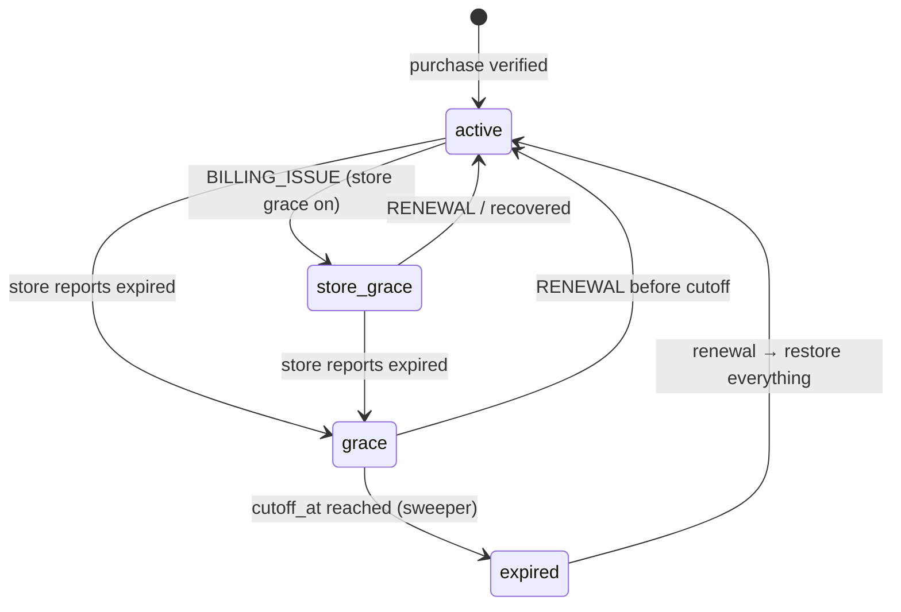

# Subscriptions and billing

Decisions: [D-008](01-decisions.md#d-008-self-profile), [D-051](01-decisions.md#d-051-revenuecat)–[D-056](01-decisions.md#d-056-suspended-data).

## Plans

| Plan | Managed patients | Self profile | Price / trial |
| --- | --- | --- | --- |
| **Starter** | **3** | Included, doesn't count toward the limit | Open ([OI-01](01-decisions.md#open-items)) |
| Others | Open | Included | Open |

- Only caregivers pay. Patients never purchase; their access follows their owner's subscription.
- The self profile **requires an active subscription** and stops when it lapses ([D-008](01-decisions.md#d-008-self-profile)).
- RevenueCat entitlement: one entitlement per plan tier (e.g. `starter`). `patient_limit` is derived server-side from the entitlement/product, never from the client.
- Store rules: auto-renewing subscriptions must last at least 7 days and be available across the user's devices. The app must describe what the user gets before asking them to subscribe (Apple 3.1.2, [R-42](references.md)).

## Quota enforcement

Only on the server ([D-053](01-decisions.md#d-053-server-only-quota)), at three points:

| Action | Endpoint |
| --- | --- |
| Create patient (`managed`) | `POST /v1/patients` |
| Accept transfer (as `managed`) | `POST /v1/transfers/redeem` |
| Re-activate patient | `POST /v1/patients/{id}/reactivate` |

```sql
BEGIN;
SELECT status, patient_limit FROM subscriptions WHERE user_id = $caller FOR UPDATE;   -- serialises concurrent creates
-- require status IN ('active','store_grace')
SELECT count(*) FROM patients WHERE owner_user_id = $caller AND type = 'managed' AND status = 'active';
-- if count >= patient_limit → ROLLBACK, 409 PATIENT_LIMIT_REACHED
INSERT/UPDATE patients …;
COMMIT;
```

Downgrades: if the limit drops below the current count, existing patients keep working (nothing is suspended for being over quota). New creates, transfers and reactivations are refused until the count is under the limit.

## Subscription states

| `subscriptions.status` | Meaning | Reminders | Writes |
| --- | --- | --- | --- |
| `active` | Entitlement active | Yes | Yes |
| `store_grace` | Store billing grace period (payment failing, store still grants access) | Yes | Yes |
| `grace` | Store reported expiry; our **1-day grace** running (`cutoff_at = expired_at + 1 day`) | Yes | Yes (warning banners) |
| `expired` | Past cutoff; patients and self profile `suspended` | No | Read-only |



## Grace

1. **Store grace first** ([D-054](01-decisions.md#d-054-no-subscription--no-use-grace)). Enable it in both stores:
   - **App Store** billing grace period: 3, 16 or 28 days (weekly subscriptions capped at 6), access kept ([R-26](references.md)).
   - **Google Play** grace period (on by default, configurable). After it, **account hold** (entitlement lost), default 60 days minus grace ([R-25](references.md)).
   - RevenueCat sends `BILLING_ISSUE` with `grace_period_expiration_at_ms`, and cancellation events on entering grace while access stays active ([R-22](references.md), [R-23](references.md)).
2. **1-day grace.** When the store reports the subscription expired: `status = 'grace'`, `expired_at = now`, `cutoff_at = expired_at + 1 day`. The trigger is RevenueCat reporting no active entitlement (`gives_access = false`), which includes Google Play account hold ([D-087](01-decisions.md#d-087-grace-trigger-and-grace-capped-windows)).
3. **Warnings:**
   - To the caregiver at expiry (push + in-app banner) and **6 hours before cutoff** (`cutoff_at − 6 h`).
   - Patient devices show **"Reminders stop tomorrow, ask your caregiver"** (sync `account_state: "grace"`).
4. During grace the server issues dose windows that end at `cutoff_at` ([D-087](01-decisions.md#d-087-grace-trigger-and-grace-capped-windows)). Phones that sync during grace then hold no alarms past cutoff, even if the cancel command never arrives.

## Cutoff

Run by the sweeper (Pass C) every minute ([D-055](01-decisions.md#d-055-cutoff)):

```sql
BEGIN;
SELECT user_id FROM subscriptions WHERE status = 'grace' AND cutoff_at <= now() FOR UPDATE SKIP LOCKED LIMIT 100;
UPDATE subscriptions SET status = 'expired' WHERE user_id = ANY($ids);
UPDATE patients SET status = 'suspended', suspended_at = now()
  WHERE owner_user_id = ANY($ids) AND status = 'active';         -- managed and self
INSERT notification_log (kind 'sync' → cancel_all) for every active device of those patients;
INSERT audit_log (billing.suspended);
COMMIT;
```

- Every patient device is told to **cancel its scheduled local alarms** and show **"Reminders paused"**: via data push, and the next sync returns `commands: ["cancel_all"]`. Otherwise alarms already on the phone fire for days.
  - Android data push is best effort ([D-075](01-decisions.md#d-075-data-pushes-are-best-effort)). iOS silent push is a bonus ([D-039](01-decisions.md#d-039-refill-paths)). The grace-window rule above bounds the damage.
- Suspended patients are excluded from dose generation, backup pushes, missed alerts and device-health alerts.

## Suspension

([D-056](01-decisions.md#d-056-suspended-data))
- Data is **kept indefinitely and read-only**. Past history is viewable: `GET …/doses`, `…/adherence`, `…/audit-log` work.
- No reminders, alerts, edits or settings changes. Writes return `403 PATIENT_SUSPENDED` / `SUBSCRIPTION_INACTIVE`.
- Deletion on request still applies under the DPDP Act ([10](10-security-privacy.md#dpdp-mapping)). Retention: [C-10](01-decisions.md#c-10-dpdp-act-and-rules--owner--legal-counsel-review-before-phase-5).

## Renewal

On `RENEWAL` / `INITIAL_PURCHASE` / `UNCANCELLATION` (or reconciliation finding an active entitlement) for an `expired` or `grace` account:
1. Set `status = 'active'`, clear `expired_at`/`cutoff_at`.
2. Set the owner's suspended patients (`suspended_at is not null`, not archived) to `active`.
3. Run dose generation for each (no end date means "runs while subscribed", [D-022](01-decisions.md#d-022-start-and-end-dates)).
4. Data push `sync` to every device. Target: **alarms re-synced within a minute** for devices that receive it. Others re-sync on next open or background run.
5. Doses scheduled during the suspension are not back-filled; they never existed.

## RevenueCat webhooks

`POST /v1/webhooks/revenuecat` ([R-21](references.md)):
1. Verify the configured authorization header (and the HMAC signature if enabled) → else `401`.
2. Insert `rc_webhook_events(event_id)` with `ON CONFLICT DO NOTHING` (table from [D-082](01-decisions.md#d-082-schema-additions)). Return `200` immediately (RevenueCat needs a response within 60 s and retries 5 times over about 80 minutes).
3. Enqueue processing. The processor ignores the event body for state and **re-fetches the customer from RevenueCat REST API v2** (recommended by RevenueCat). It maps active entitlements → plan, `patient_limit`, `renews_at`, status. Store `last_event_id`.
4. Use `app_user_id` = `users.id` (set via `Purchases.logIn` after sign-in). Look users up by `original_app_user_id` and `aliases` too ([R-22](references.md)).
5. Events of interest: `INITIAL_PURCHASE`, `RENEWAL`, `CANCELLATION`, `UNCANCELLATION`, `BILLING_ISSUE`, `EXPIRATION`, `PRODUCT_CHANGE`, `SUBSCRIPTION_PAUSED`, `SUBSCRIPTION_EXTENDED`, `TRANSFER`, `TEMPORARY_ENTITLEMENT_GRANT`. Others: log and ignore.
6. Sandbox events are processed only in non-production environments.

## Reconciliation

`rc-reconcile` Job Scheduler, daily ([D-051](01-decisions.md#d-051-revenuecat)):
- For every user with `status IN ('active','store_grace','grace')`, and every `expired` user (suggested: those expired within the last 90 days), fetch the customer via API v2 (respect 480 req/min, [R-24](references.md)). Apply the same mapping as webhooks.
- Report mismatches fixed (metric + log). A mismatch rate above a threshold (suggested 0.5% per day) pages the owner, since it means webhooks are being missed.

## Client behaviour

- Paywall before the first patient is created, and when the self profile is added without a subscription.
- After purchase: `POST /v1/subscription/refresh`, then proceed only on the server's answer. The client never decides entitlement.
- Banners: grace (caregiver and patient), expired (caregiver: renew; patient: "Reminders paused").
